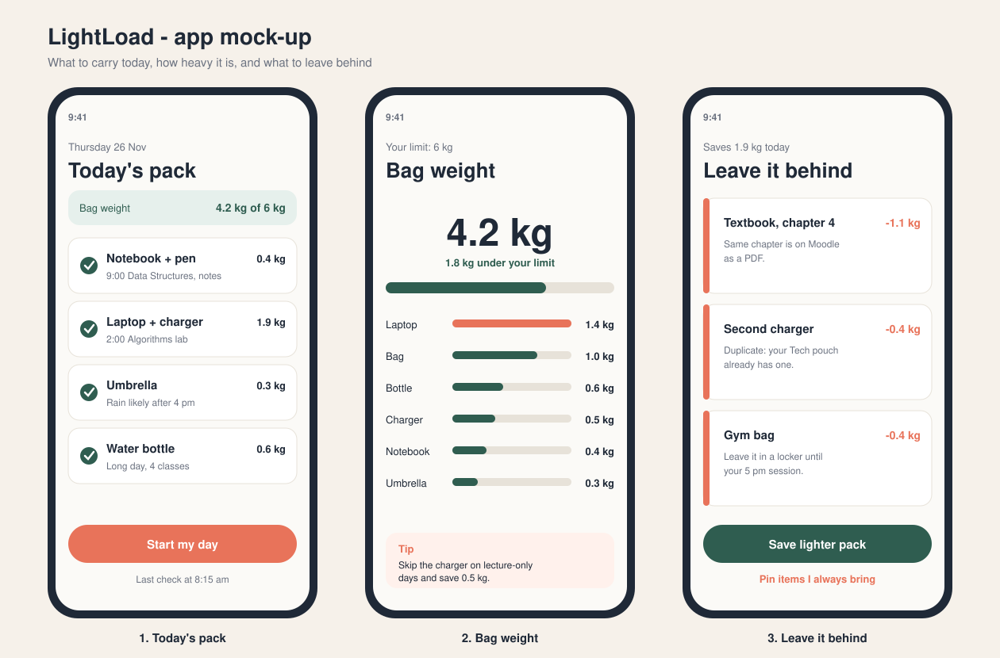

# Lab 02 - AI in Everyday Challenges

## Laboratory Session
Lab 02 - PUSL3205 Large Language Models and Generative AI

## Objective
Use an LLM as a product-development partner to design a product for an everyday student problem, with a concept, name, key features, target user and a visual mock-up.

## Challenge chosen
**Group 7 - The Overloaded Student.** A typical university day needs a laptop, charger, phone, books, notebooks, stationery, a water bottle, headphones, an ID card and more, and carrying it all is uncomfortable. The challenge is to help students carry, organise or reduce what they take with them.

I was absent on the day groups were formed and was not assigned one, so I completed this lab individually. I let the LLM choose the problem, and Group 7 was picked because a carrying system gives plenty of room for a visual design.

## How I used the LLM
1. **Choosing the problem:** I asked the LLM to select a group for me. It chose Group 7 and explained why.
2. **Comparing options:** it proposed three solutions and compared them.

| Option | Idea | Strength | Weakness |
|---|---|---|---|
| A. Smart backpack | Bag with weight sensors and compartments | Impressive to look at | Needs hardware, costly, hard to prototype |
| B. LightLoad | App that says what to carry each day, plus an optional pouch kit | Cheap to build and test, the LLM does real work | Depends on students entering their timetable |
| C. Locker-share network | Shared lockers so students carry less | Removes weight physically | Needs the university's infrastructure |

3. **Developing the concept:** the LLM wrote the concept, target user, features and weaknesses for option B. I reviewed it and approved it.
4. **Mock-up:** the LLM generated the three screens as an SVG image.
5. **My own changes:** I did not change the concept. I read the options, the features and the limitations, and approved it as proposed. My own decisions were to do the lab individually, to let the LLM choose the problem, and to go with option B (the app with an optional pouch kit) over the smart backpack and the locker network.

## The product: LightLoad
**One line:** every morning, LightLoad reads your timetable and tells you what to bring today, what to leave behind, and how heavy your bag will be.

**Target user:** university students who commute by bus or train and carry a laptop every day, with mixed days of lectures, labs and activities, especially first and second years who have not yet learned what they really need.

**Problem:** students pack for the worst case and carry everything "just in case". The bag gets heavy, and they still sometimes forget the one thing a class needs.

**Key features**
1. **Today's pack:** imports the timetable and uses an LLM to decide what each class needs.
2. **Leave it behind:** suggests what to skip or keep in a locker, with a reason and digital swaps.
3. **Bag weight meter:** adds up item weights (editable) and compares them with a limit the user sets.
4. **Last check before leaving:** a short checklist at leaving time for ID, charger and keys.
5. **Weather adjustments:** umbrella, jacket or extra water depending on the day.
6. **Optional pouch kit:** three colour-coded pouches (Tech, Study, Daily). This is a design extension and the app works without it.

**Where the LLM is used:** turning the timetable, assignments and weather into a plain-language packing decision with reasons, and handling odd cases such as a group meeting followed by the gym.

## Visual prototype

The screens show today's pack with a weight summary, the bag weight breakdown, and the leave-it-behind suggestions. They are static mock-ups, not a working app.

## Limitations
- Setup friction: if importing the timetable is a hassle, students will not use it.
- The LLM cannot know everything a class needs (for example a printed handout), so users need a way to pin items they always bring.
- Item weights are estimates, so the meter is a guide, not a measurement.
- A timetable is personal data, so the app should store as little as possible and say what it stores.
- It helps students who over-pack most. Students who already pack carefully gain less.
- The concept was not tested with real students. The example items, weights and times in the mock-up are made up for illustration.

## Observations
- The LLM was fast at comparing options and turning a vague problem into a structured concept.
- Its suggestions were safe and familiar. The ideas came from common patterns, so the originality has to come from me.
- It stated assumptions confidently (for example that lecturers upload PDFs to Moodle) that I would need to check with real students.
- The mock-up is only as good as my review of it, since a generated design can look polished while hiding usability problems.
- I approved the concept without testing any of its assumptions, for example that students would enter a timetable or that lecturers share material as PDFs. The concept is only as reliable as those assumptions, and the next step would be asking a few students.
- Working alone, there was no teammate to challenge the idea, so the limitations section is where the doubts have to be raised.

## Learning Outcomes
- How to use an LLM for structured brainstorming, option comparison and drafting a product concept
- How to judge LLM output critically instead of accepting it, including which parts are assumptions
- How to write a product concept with a target user, features and honest limitations

