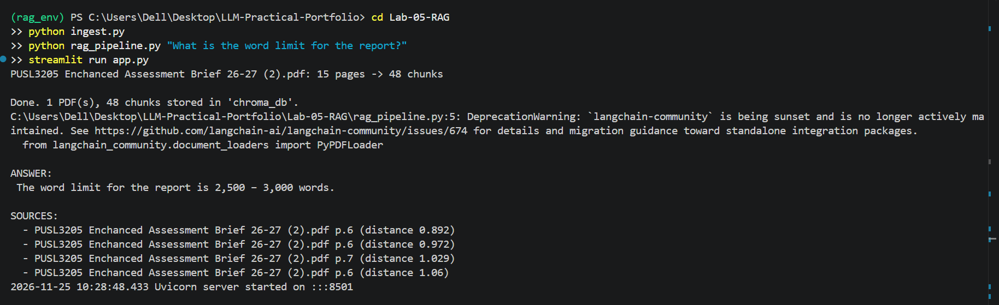
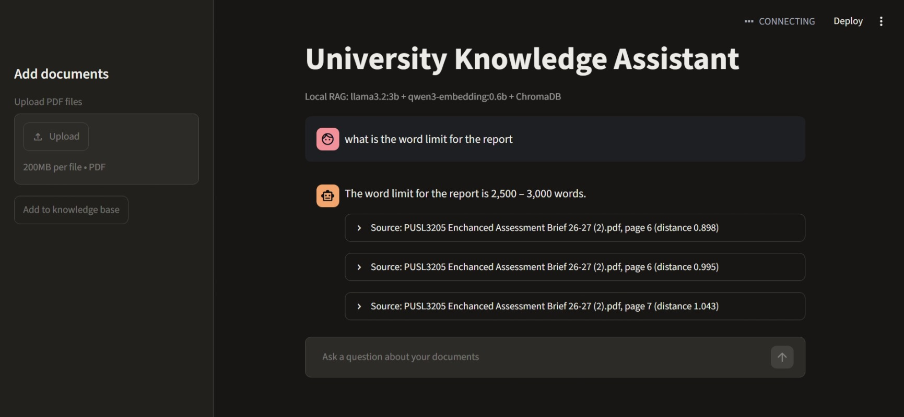
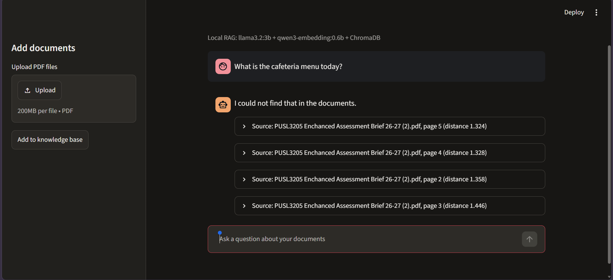
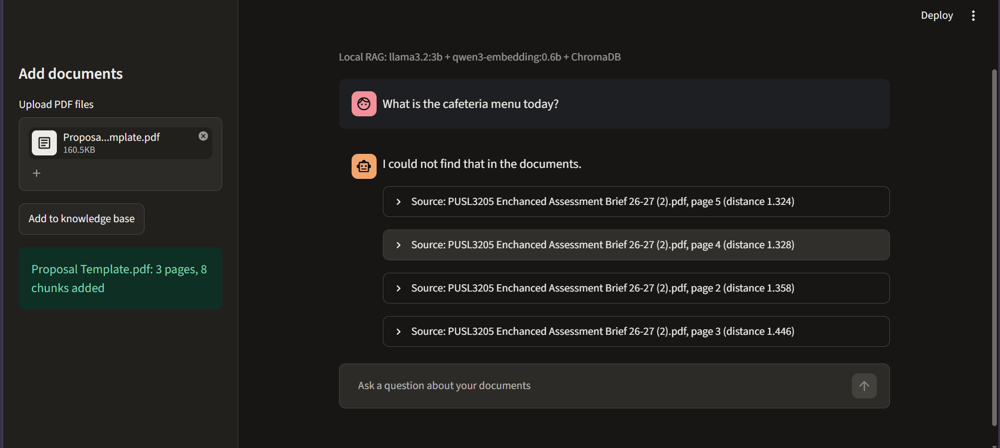

# Lab 05 - RAG Architecture

## Laboratory Session
Lab 05 - PUSL3205 Large Language Models and Generative AI

## Objective
Build a local Retrieval-Augmented Generation (RAG) application that answers questions from PDF documents, and let users upload their own PDFs.

## Setup
- Python 3.12 virtual environment (`rag_env`), dependencies in `requirements.txt`
- LLM: Llama 3.2 3B via Ollama
- Embedding model: Qwen3 Embedding 0.6B via Ollama
- Vector database: ChromaDB
- Interface: Streamlit

## How to run
1. `ollama pull llama3.2:3b` and `ollama pull qwen3-embedding:0.6b`
2. Put PDFs in `data/` (not included in the repo)
3. `python ingest.py` to build the vector database
4. `streamlit run app.py` to open the chat window (PDFs can also be uploaded in the sidebar)

## Implementation
- `ingest.py` - reads every PDF in `data/` and builds the database
- `rag_pipeline.py` - splits PDFs into 800-character chunks (150 overlap), embeds and stores them, retrieves the top 4 chunks for a question, and builds a prompt that tells the LLM to answer only from the context
- `app.py` - chat interface with source chunks shown under each answer and PDF upload in the sidebar (the lab task)

## Results and Evidence
Test document: the PUSL3205 assessment brief (15 pages, 48 chunks).

| Question | Answer | Result |
|---|---|---|
| When is the report due? | Gave the 16:00 SL deadline time but not the date | Partly correct |
| What is the word limit for the report? | 2,500 - 3,000 words | Correct |
| What is the cafeteria menu today? | "I could not find that in the documents." | Correct refusal |

Retrieval distances (lower = closer): the refused question had the highest distances (1.32 - 1.45); answerable questions were 0.89 - 1.22. Only three questions were tested, so this is a pattern to investigate, not a conclusion.

## Observations
- The pipeline answered from the document and refused a question that was not in it.
- The incomplete deadline answer shows RAG can still miss details. TODO: state whether the date was in the retrieved chunks (retrieval problem) or in the chunks but ignored by the LLM (generation problem).
- A 3B model running locally was slow (roughly 10 - 60 seconds per answer).

## Challenges
- Windows Application Control blocked PyMuPDF (`_mupdf` could not load). I replaced it with `pypdf`, which is pure Python.
- Re-running ingestion would duplicate chunks, so `ingest.py` rebuilds the database each time and `add_pdf` removes old chunks of the same file first.

## Learning Outcomes
- How ingestion, embedding, retrieval and generation fit together in RAG
- Why chunk size and overlap affect what the model can see
- How a prompt rule reduces unsupported answers but does not guarantee correctness

## Screenshots

