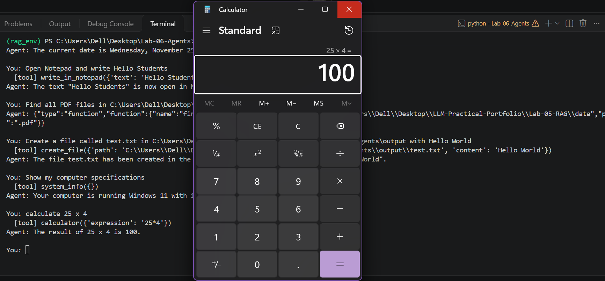
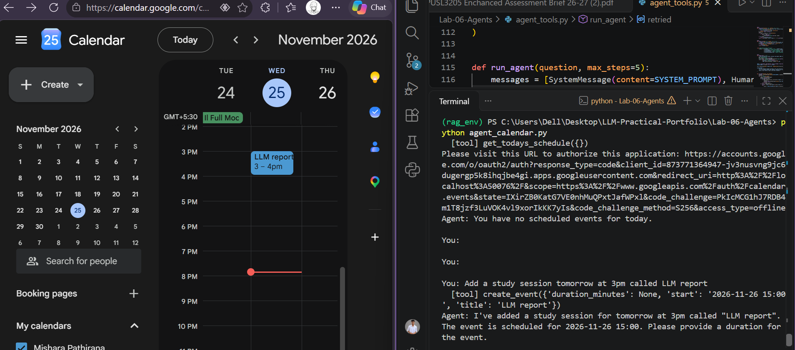

# Lab 06 - Tool-Using AI Agent with Ollama

## Laboratory Session
Lab 06 - PUSL3205 Large Language Models and Generative AI

## Objective
Build an AI agent on a local LLM (Llama 3.2 3B via Ollama) that decides when to call tools, then extend it step by step: a multi-tool agent (Part A and exercise), SQLite memory (Part B), a RAG tool built on Lab 05 (Part C) and Google Calendar tools (Part D).

## Setup
- Python 3.12 environment (the same `rag_env` as Lab 05), libraries in LangChain (`langchain-core`, `langchain-ollama`), `pyautogui`, `pygetwindow`, and the Google API client libraries
- Ollama running `llama3.2:3b`
- Part C needs the Lab 05 vector database (`../Lab-05-RAG/chroma_db`), built with `python ingest.py`
- Part D needs your own Google Cloud OAuth `credentials.json` (not included in the repo). The first run opens a browser login and creates `token.json`
- Run any part with `python <file>.py` from this folder

## Implementation
| File | Part | What it does |
|---|---|---|
| `agent_tools.py` | A + exercise | Six tools: calculator (opens Windows Calculator and types the expression), date and time, write in Notepad, file search, file creation, system information. Contains the agent loop |
| `agent_memory.py` | B | Saves what the user says to a SQLite database (`memory.db`) and adds a `search_memory` tool. Also holds the reusable `build_agent` and `chat_loop` functions |
| `agent_rag.py` | C | Adds a `search_documents` tool that calls the Lab 05 RAG pipeline, next to the calculator and memory tools |
| `agent_calendar.py` | D | Adds `get_todays_schedule` and `create_event` for Google Calendar. Creating an event asks the user to approve with y/n first |

How the agent works: tools are written as normal Python functions with the `@tool` decorator, and the model reads their names, type hints and docstrings. `bind_tools` tells the model which tools exist. In the agent loop, the model is asked, any tool it requests is run, the result goes back to the model as a `ToolMessage`, and this repeats until the model answers without requesting a tool (limited to 5 steps).

## Results and Evidence

**Part A and exercise**

| # | Query | Tool called | Result |
|---|---|---|---|
| 1 | Calculate 25 x 4 | calculator | Worked, answer 100 |
| 2 | What is the date today? | get_datetime | Worked |
| 3 | Open Notepad and write Hello Students | write_in_notepad | Worked |
| 4 | Find all PDF files in a folder | find_files | Failed first: the model printed the tool call as text and no tool ran. Worked after adding a retry |
| 5 | Create test.txt with Hello World | create_file | Worked |
| 6 | Show my computer specifications | system_info | Worked |

**Part B (memory)**: told the agent "My name is Alex", asked "What is my name?", restarted the program and asked again, and it still answered correctly from the database. The calculator tool also worked in the same agent.

**Part C (RAG agent)**: the agent picked `search_documents` for questions about the assessment brief, `search_memory` for personal details and `calculator` for maths, and gave the "could not find" answer for a question the documents do not cover. All tests behaved as expected.

**Part D (Google Calendar)**: the agent listed today's events, created an event after approval (verified in Google Calendar), and created nothing when the approval was refused.

Screenshots are at the bottom of this page.

## Observations
- In Part A the model picked the right tool with the right arguments in 5 of 6 queries on the first try. In query 4 it wrote the tool call as plain JSON text instead of calling it, which is a weakness of a small 3B model. I added a check in the loop: if the reply starts like a JSON tool call, tell the model once to call the tool properly and try again. That fixed it.
- The agent says things it cannot see. After the Notepad query it said the text was displayed, but the tool only reports that it typed the text, and nothing checks the screen.
- The memory search is a keyword search (SQL `LIKE`), so it only finds notes that share a word with the keyword the model chooses. A note about "tea" would not be found by a query for "drink". Embeddings would handle this better, like the RAG tool does.
- Each question starts fresh, so everything the agent remembers comes from the database. Questions (messages ending in `?`) are not saved, so they do not clutter later searches.
- In Part C every document question needs the agent LLM call, retrieval and a second LLM call inside the RAG tool, so it is noticeably slower than the other tools.
- Part D creates events only after approval, because a small model should not be able to change a real calendar on its own.

## Challenges
- Windows Application Control blocks some packages with compiled files, so the system information tool uses `ctypes` instead of `psutil`.
- Two Python environments are in use (`.venv` for Lab 01 and `rag_env` for Labs 05 and 06), and a new terminal sometimes activated the wrong one, which caused import errors.
- The calculator and Notepad tools type into whichever window has focus, so the keyboard and mouse must not be used while they run.
- Google login needs the account added as a test user in the OAuth consent screen. `credentials.json`, `token.json` and `memory.db` are kept out of the repository with `.gitignore`.

## Learning Outcomes
- How an agent loop lets an LLM choose and chain tools
- How tool names, docstrings and type hints guide the model's choices
- Why input from an LLM has to be validated before it is used (the calculator only accepts numbers and basic operators)
- How to give an agent persistent memory, reuse a RAG system as a tool, and connect it to an external API with OAuth

## Screenshots

